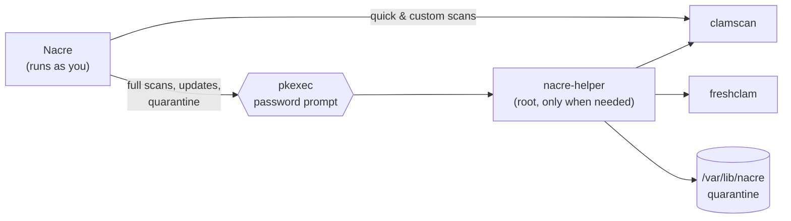

<div align="center">


# Nacre

**A modern, friendly antivirus for Linux — powered by the ClamAV engine.**

Quick, full and custom scans · one-click definition updates · quarantine · 30-day activity log

[](https://github.com/cyb3rl00m/nacre/releases/latest)
[](https://github.com/cyb3rl00m/nacre/releases)
[](LICENSE)
[](https://github.com/cyb3rl00m/nacre/commits)
<br>
[](https://gnome.pages.gitlab.gnome.org/libadwaita/)
[](https://www.python.org/)
[](https://www.clamav.net/)
[](https://claude.ai)

[**Download**](https://github.com/cyb3rl00m/nacre/releases/latest) ·
[Features](#-features) ·
[Install](#-installation) ·
[How it works](#-how-it-works) ·
[FAQ](#-faq)

<br>


</div>

---

## ✨ Why Nacre?

Linux has an excellent open-source antivirus engine in ClamAV, but it lives in the terminal. Nacre puts it behind a clean, native GNOME-style interface: you can see whether your definitions are fresh, run a scan with one click, and deal with anything it finds without typing a single command.

> **Nacre** is mother-of-pearl — the layer a clam builds around anything harmful that gets inside its shell, sealing it away for good.

## 🧰 Features

| | |
|---|---|
| **⚡ Quick scan** | Checks where threats usually land: Downloads, Desktop, `/tmp`, `/var/tmp`, `/dev/shm`, `~/.local/bin`, autostart entries and app launchers. No password needed. |
| **🖥️ Full system scan** | Every file on the computer, scanned as administrator. Pseudo-filesystems (`/proc`, `/sys`, `/dev`, `/run`) are skipped; USB drives are optional. |
| **📁 Custom scan** | Pick folders or files, or drag & drop them onto the window. Optional administrator mode for files you don't own. |
| **🌙 Shut down when done** | Tick a box and the computer powers off after a full scan — with a 60-second countdown to cancel. Perfect for overnight scans. |
| **📊 Live progress** | Files checked, threats found, elapsed time, current file and an estimated percentage. |
| **🔄 One-click updates** | Runs ClamAV's `freshclam` and shows its output live. Warns you when definitions are out of date. |
| **🔒 Quarantine** | Threats are moved to a root-only vault and stored scrambled, so they can't run or be opened. Restore false alarms or delete permanently — one by one or all at once. |
| **📜 Activity log** | Every scan, result, threat, quarantine action, update and settings change from the last 30 days. Searchable, filterable, exportable. Older entries are removed automatically. |
| **⚙️ Preferences** | Archive scanning, potentially-unwanted-app detection, max file size, low-priority mode (keeps games smooth), auto-quarantine, notifications, excluded folders. |
| **🎨 Native look** | GTK 4 + libadwaita: light/dark mode, your accent color, adaptive layout down to phone width, desktop notifications. |

## 📦 Installation

### Ubuntu · Pop!_OS · Debian · Linux Mint · Zorin OS

1. Download the latest `nacre_*_all.deb` from the [**Releases page**](https://github.com/cyb3rl00m/nacre/releases/latest).
2. Install it — apt pulls in ClamAV and everything else automatically:

```bash
sudo apt install ./nacre_*_all.deb
```

3. Open **Nacre** from your app menu. If virus definitions haven't been downloaded yet, click **Download Definitions**.

To uninstall: `sudo apt remove nacre` (add `--purge` to also delete the quarantine).

### From source

```bash
git clone https://github.com/cyb3rl00m/nacre.git
cd nacre
./install.sh          # installs dependencies with apt, then Nacre
./uninstall.sh        # removes it again
```

Or try it without installing: `./run.sh`

<details>
<summary><b>Fedora, Arch and other distros (untested)</b></summary>

<br>

Nacre should run on any distro with libadwaita 1.5+. Install the dependencies with your package manager, then run `./install.sh --no-deps`:

```bash
# Fedora
sudo dnf install python3-gobject gtk4 libadwaita clamav clamav-update polkit

# Arch / Manjaro / EndeavourOS
sudo pacman -S python-gobject gtk4 libadwaita clamav polkit
```

The automatic-shutdown option needs systemd.

</details>

### Requirements

| Component | Version |
|---|---|
| Distribution | Ubuntu 24.04+, Pop!_OS 24.04+, Debian 13+, Linux Mint 22+, Zorin OS 18+ |
| libadwaita | **1.5 or newer** |
| GTK | 4.12+ |
| Python | 3.10+ with PyGObject |
| ClamAV | `clamav` + `clamav-freshclam` |
| polkit | `pkexec` |

## 🔍 How it works



- **Least privilege.** Quick and custom scans run as your user. Only full scans, definition updates and quarantine actions go through a small helper started with `pkexec`, so you get your desktop's normal password prompt. The password is remembered for a few minutes.
- **No raw commands.** The helper never accepts arbitrary command lines — it builds every `clamscan` and `freshclam` call itself from a few validated options.
- **Safe quarantine.** Files are XOR-scrambled and stored in `/var/lib/nacre/quarantine` (`root:root`, mode `0700`). Restoring writes back the exact original bytes, owner and permissions, verifies the SHA-256, and never overwrites an existing file.
- **Unattended-friendly.** With auto-quarantine on, full scans quarantine threats inside the same privileged run, so nothing waits on a password prompt while you're away.
- **Plays nice with the updater.** Updating briefly pauses the `clamav-freshclam` background service (which holds the database lock) and starts it again afterwards.

<details>
<summary><b>Where Nacre stores its files</b></summary>

<br>

| Path | Contents |
|---|---|
| `~/.config/nacre/settings.json` | Your preferences |
| `~/.local/share/nacre/activity.jsonl` | Activity log (last 30 days) |
| `~/.local/share/nacre/state.json` | Last scan result |
| `/var/lib/nacre/quarantine/` | Quarantined files (root only) |
| `/var/lib/nacre/quarantine.json` | Quarantine list (readable, so the app can show it without a password) |

</details>

## ❓ FAQ

<details>
<summary><b>Does Nacre protect me in real time?</b></summary>
<br>
No — Nacre is an on-demand scanner. ClamAV's real-time scanner (<code>clamonacc</code>) needs extra system configuration; support may come in a future version.
</details>

<details>
<summary><b>Why does a scan take a moment to start?</b></summary>
<br>
ClamAV loads its entire signature database — millions of signatures, roughly 1 GB of RAM — before it checks the first file. That takes 10–40 seconds depending on your computer.
</details>

<details>
<summary><b>A file I trust was flagged. What now?</b></summary>
<br>
Use <b>⋯ → Ignore</b> on the threat, or quarantine it and restore it later. Add its folder under <b>Preferences → Excluded folders</b> so it's skipped in future scans.
</details>

<details>
<summary><b>How can I test it safely?</b></summary>
<br>
Use the harmless <a href="https://www.eicar.org/download-anti-malware-testfile/">EICAR test file</a>, which every antivirus detects on purpose.
</details>

<details>
<summary><b>Is Nacre affiliated with ClamAV or Cisco?</b></summary>
<br>
No. Nacre is an independent front end that uses the ClamAV engine installed on your system.
</details>

## 🗺️ Roadmap

- [ ] Real-time protection via `clamonacc`
- [ ] Scheduled scans
- [ ] "Scan with Nacre" in the file manager's right-click menu
- [ ] Native packages for Fedora and Arch (and Flatpak, if possible with a system ClamAV)
- [ ] Translations

Ideas and bug reports are welcome in [Issues](https://github.com/cyb3rl00m/nacre/issues).

## 🛠️ Development

```bash
python3 -m unittest discover -s tests -v   # run the test-suite
./build-deb.sh                             # build dist/nacre_<version>_all.deb
```

The tests use a fake `clamscan` and a temporary state folder, so they need neither root nor a real virus database.

<details>
<summary><b>Project layout</b></summary>

```
nacre/              the app (Python package)
  ui/               pages: overview, scan, quarantine, logs, preferences, update dialog
  runner.py         runs the helper in the background
  clamav.py         clamscan output parsing, engine info
  activity_log.py   the 30-day activity log
helper/             nacre-helper — the privileged part
data/               desktop file, icon, polkit policy, AppStream metainfo
tests/              unit and smoke tests
```

</details>

## 🤝 Contributing

Pull requests are welcome! For bigger changes, please open an issue first so we can talk about it. Please run the tests before submitting.

## 📄 License

Nacre is released under the [MIT License](LICENSE).

<sub>ClamAV® is a registered trademark of Cisco Systems, Inc. Nacre is an independent project and is not affiliated with or endorsed by Cisco.</sub>
