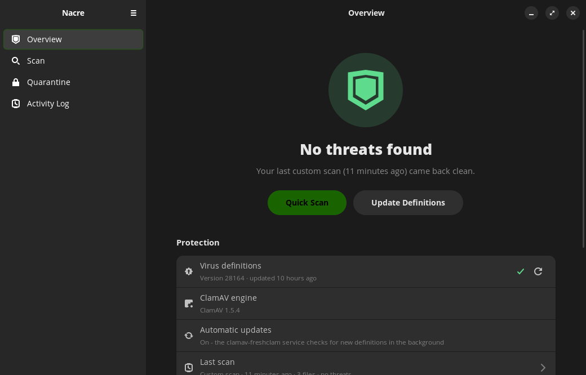

<p align="center">
  
</p>

<h1 align="center">Nacre</h1>

<p align="center">
  A modern, friendly antivirus app for Linux, powered by the <a href="https://www.clamav.net/">ClamAV</a> engine.<br>
  Built with GTK 4 and libadwaita for Pop!_OS, Ubuntu, Debian and their derivatives.
</p>

[](https://github.com/cyb3rl00m/nacre/releases/latest)
[](#credits)
[](LICENSE)


---

<br>



</div>

<br>

## Features

- **Quick scan** – checks the places threats usually land: Downloads, Desktop, `/tmp`, `/var/tmp`, `/dev/shm`, `~/.local/bin`, your autostart entries and app launchers.
- **Full system scan** – checks every file on the computer as administrator (pseudo-filesystems like `/proc` and `/sys` are skipped; USB drives are optional).
- **Custom scan** – pick folders or files, or just drag them onto the window. From a terminal: `nacre ~/Downloads/suspicious.zip`.
- **Shut down when done** – tick a box before (or during) a full scan and the computer turns itself off when the scan finishes. You get a 60-second countdown to cancel, and with auto-quarantine on, threats are quarantined before it shuts down – no password prompt needed while you're away.
- **Live progress** – files checked, threats found, elapsed time, the file being scanned and an estimated percentage.
- **One-click definition updates** – runs ClamAV's `freshclam` and shows its output.
- **Quarantine** – infected files are moved into a locked, root-only folder and stored scrambled so they can't run or be opened by accident. Restore them if it was a false alarm, delete them one by one or all at once.
- **Delete in place** – or remove a threat permanently straight from the scan results.
- **30-day activity log** – every scan and its result, every threat found, every quarantine/restore/delete, definition updates and settings changes. Entries older than 30 days are removed automatically (checked on start-up and every hour), so the log never grows big. Search, filter, export to text.
- **Preferences** – scan inside archives, detect potentially unwanted apps (PUA), maximum file size, low-priority scanning (keeps games smooth), auto-quarantine, notifications and excluded folders.
- Light and dark mode, adaptive layout, desktop notifications when a scan finishes in the background.

## Requirements

| | |
|---|---|
| Distro | Ubuntu 24.04+, Pop!_OS 24.04+, Debian 13+, Linux Mint 22+, Zorin 18+, … |
| Runtime | Python 3.10+, GTK 4, libadwaita **1.5+**, PyGObject |
| Engine | `clamav` and `clamav-freshclam` |
| Password prompts | `pkexec` (polkit) |

## Install

### Option 1 – .deb package (recommended)

Download `nacre_x.y.z_all.deb` from the Releases page, then:

```bash
sudo apt install ./nacre_1.0.1_all.deb
```

apt pulls in ClamAV and everything else automatically. To build the .deb yourself: `./build-deb.sh` → `dist/`.

### Option 2 – install script

```bash
git clone https://github.com/cyb3rl00m/nacre.git
cd nacre
./install.sh
```

Remove it again with `./uninstall.sh`.

### Option 3 – run from the source folder

```bash
sudo apt install python3-gi gir1.2-gtk-4.0 gir1.2-adw-1 clamav clamav-freshclam pkexec
./run.sh
```

### First start

Ubuntu/Debian usually download the virus definitions in the background right after installing ClamAV. If they're missing, Nacre shows a **Download Definitions** button.

## How it works

```
 Nacre (GTK app, runs as you)
   │  scan / quarantine / update requests
   ▼
 pkexec ──► nacre-helper  (small Python program, runs as root only when needed)
              ├─ clamscan   – scanning
              ├─ freshclam  – definition updates
              └─ /var/lib/nacre/quarantine  – locked quarantine folder
```

- **Quick and custom scans run as you** – no password needed. Turn on *Use administrator rights* for a custom scan to include files you don't own.
- **Full scans, updates and quarantine actions** go through the helper, so you get your desktop's normal password prompt. Your password is remembered for a few minutes, so quarantining several files only asks once.
- The helper never accepts raw command lines: it builds every `clamscan`/`freshclam` call itself from a few validated options.
- Updating pauses the `clamav-freshclam` background service while `freshclam` runs (otherwise it holds the database lock), then starts it again.
- **Quarantine**: files are XOR-scrambled and moved to `/var/lib/nacre/quarantine` (`root:root`, mode `0700`). The list of quarantined items (`/var/lib/nacre/quarantine.json`) is readable so the app can show it without a password. Restoring writes the exact original bytes back with the original owner and permissions, and checks the SHA-256. If a file with the same name exists, the restored copy is saved as `name.restored` instead of overwriting.
- Your settings live in `~/.config/nacre/`, the activity log and last scan result in `~/.local/share/nacre/`.

## FAQ

**Does Nacre protect me in real time?**
No – it's an on-demand scanner, like ClamTk. ClamAV's real-time scanning (`clamonacc`) needs extra system configuration and may come in a later version.

**Why does the first scan take a while to start?**
ClamAV loads its whole signature database (millions of signatures, about 1 GB of RAM) before it scans the first file. That takes 10–40 seconds.

**I got a detection in a file I trust.**
Open the threat's ⋯ menu and choose *Ignore*, or quarantine it and restore it later. Add the folder to *Preferences → Excluded folders* to skip it in future scans.

**How do I test it safely?**
Use the harmless [EICAR test file](https://www.eicar.org/download-anti-malware-testfile/), which every antivirus detects on purpose.

## Development

```bash
python3 -m unittest discover -s tests -v
```

The tests use a fake `clamscan` and run the helper against a temporary state folder, so they don't need root or a real ClamAV database. `tests/gui_smoke.py` drives the window code end-to-end against a stand-in for GTK.

Project layout:

```
nacre/            the app (Python package)
  ui/               pages: overview, scan, quarantine, logs, preferences, update dialog
  runner.py         runs the helper in the background
  clamav.py         clamscan output parsing, engine info
  activity_log.py   the 30-day log
helper/             nacre-helper (privileged part)
data/               desktop file, icon, polkit policy, metainfo
```

## License

MIT – see [LICENSE](LICENSE).

ClamAV® is a registered trademark of Cisco Systems, Inc. Nacre is an independent project and is not affiliated with or endorsed by Cisco.
